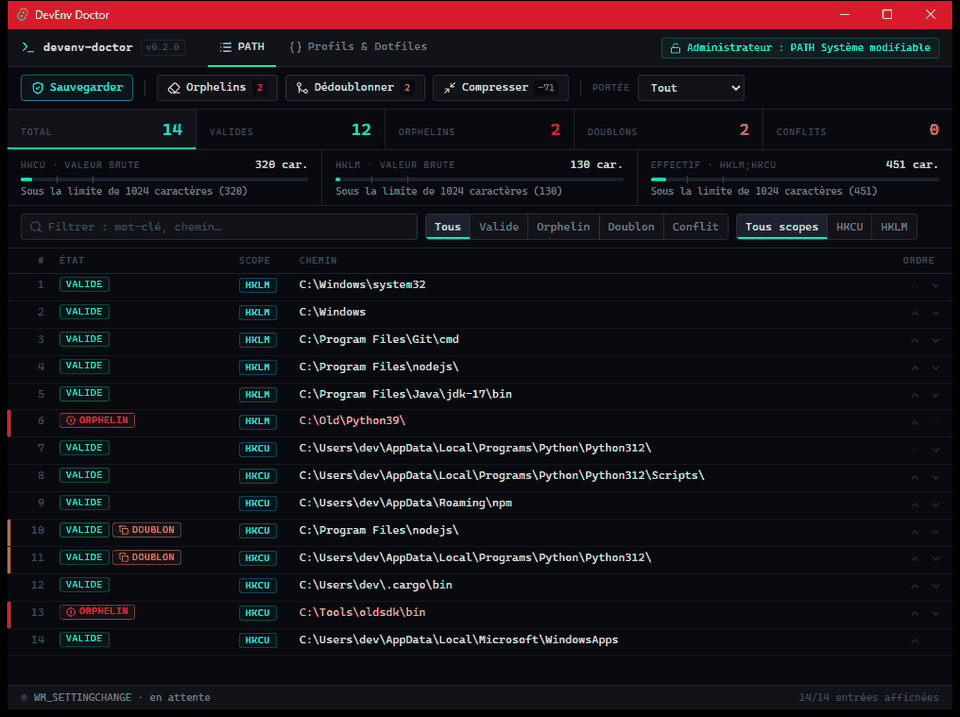
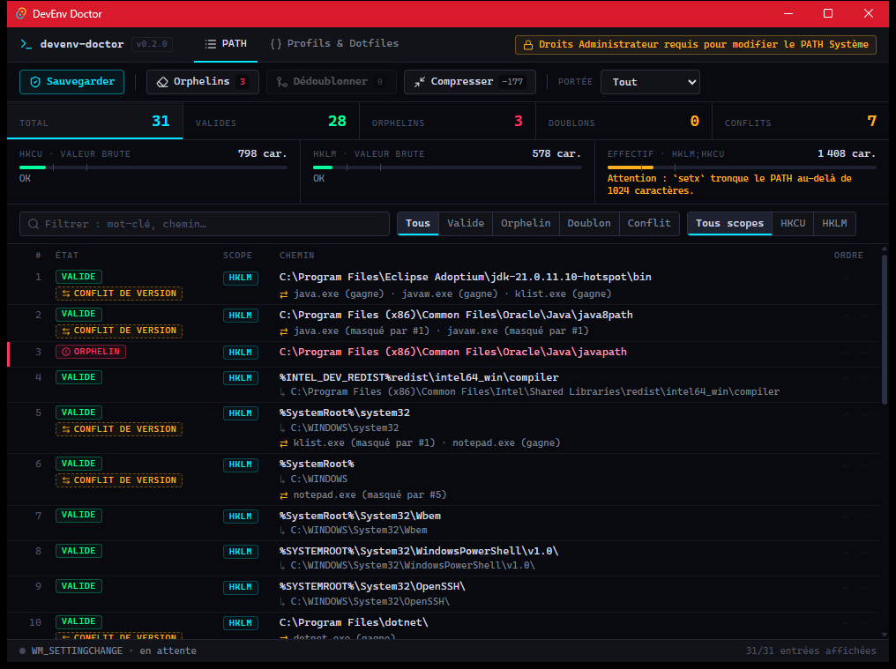
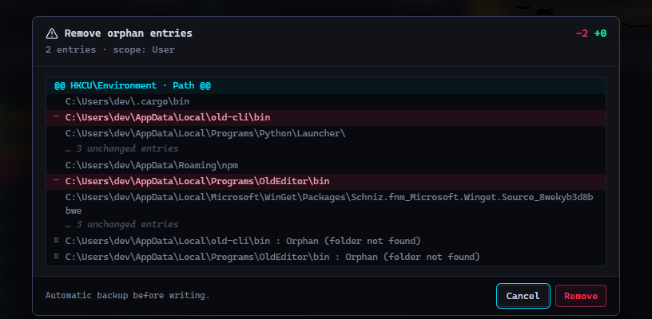

# DevEnv Doctor (v0.2.0)

🇫🇷 [Version française](README.md)

[](https://github.com/TxF-AI/devenv-doctor/releases/latest)


[](LICENSE)

**A smart manager and cleaner for the Windows `PATH` and environment variables.**

Over the years of installing Python, Node, Java, Git, SDKs…, the `PATH` fills up with folders that no longer exist, duplicate entries, and binaries that shadow each other. DevEnv Doctor reads the registry, shows you exactly what is wrong, then fixes it with a preview, an automatic backup and one-click restore.

Native desktop app (Rust + Tauri v2), a single executable under 5 MB. Nothing is sent over the Internet. The interface is available in **French and English** (FR/EN selector in the top bar; defaults to the system language and is remembered).

## 🎨 Interface preview



*Animated demo (fictitious data): duplicates removed with a "diff" preview, then PATH compression (−59 characters).*

<details>
<summary>Static screenshots</summary>

<p align="center">
  
</p>

A compact **cyberpunk HUD** designed as a developer tool: obsidian background, accent colors reserved for statuses, monospace font. The dense table lists the PATH in Windows resolution order, with **dynamic filters** (keyword, state, scope), **Valid / Orphan / Duplicate / Version conflict** badges (a red or amber bar on the side flags rows that need attention), PATH length gauges and ⬆ / ⬇ priority buttons.

<p align="center">
  
</p>

Before any write, a **"Git diff" style confirmation modal** shows exactly what will be removed (red `−` lines, unchanged entries collapsed). In these screenshots the Windows user name is masked (`dev`).

</details>

## Features

- 🧹 **Smart cleanup**: detects **orphans** (folders that no longer exist) and **duplicates**, in both the User (HKCU) and System (HKLM) PATH. Entries whose absence is uncertain (unresolved variable, network path) are left alone.
- ⚡ **Live broadcast**: after every change, DevEnv Doctor broadcasts `WM_SETTINGCHANGE` to Windows. **New** terminals and programs see the change without restarting the session (programs that are already open keep their old environment).
- 📏 **PATH compressor & diagnostics**: length of HKCU, HKLM and the effective PATH, with a warning before the **1024** (`setx`), **2048** and **8192** character limits. Compression replaces `C:\Users\<name>`, `AppData` and the Windows folder with variables (`%USERPROFILE%`, `%LOCALAPPDATA%`, `%APPDATA%`, `%windir%`), only when the entry becomes shorter.
- ⚠️ **Conflict detection**: finds same-name binaries in several PATH folders (`python.exe`, `node.exe`, `git.exe`…), tells you which one Windows runs and which ones are shadowed. The ⬆ / ⬇ buttons on each row adjust priority.
- 🛡️ **Safety & backups**: no write without a "diff" preview and confirmation. A JSON backup is created automatically in `%APPDATA%\com.txfai.devenvdoctor\backups\`, with **one-click restore**. Changing the System PATH requires running the app as administrator.
- 📜 **Dotfiles & PowerShell export**: export the PATH and user variables as JSON (profiles and `Minimal Clean`, `WebDev`, `GameDev` presets) or as a standalone `setup-env.ps1` script to set up a fresh PC. Exports contain **no secrets** (variables whose name suggests a token, key or password) and **no user name**.

## Installation

1. Download the executable: **[devenv-doctor.exe (v0.2.0)](https://github.com/TxF-AI/devenv-doctor/releases/download/v0.2.0/devenv-doctor.exe)** (4.5 MB), or see the [v0.2.0 release page](https://github.com/TxF-AI/devenv-doctor/releases/tag/v0.2.0).
2. Check its hash:

   ```powershell
   Get-FileHash -Algorithm SHA256 .\devenv-doctor.exe
   ```

   The result must be:

   ```
   68E2E215D1A2B2621E404A4F0B3AF56F67F0DD4A86AB485D8070F1CD0086F986
   ```

3. Double-click `devenv-doctor.exe`. No installation: the file is portable.

**Requirements:** Windows 10 or 11 (64-bit) with Microsoft Edge WebView2, already present on Windows 11 and up-to-date Windows 10.

> ### ⚠️ Windows SmartScreen
> The executable is **not digitally signed** (no code-signing certificate). On first launch Windows may show "Windows protected your PC": click **More info**, then **Run anyway**. Always compare the SHA-256 hash above before running it. You can also remove the block with `Unblock-File .\devenv-doctor.exe`.

## Usage

- **PATH tab**: a single table (System then User, in Windows resolution order) with the state of each entry: Valid, Orphan, Duplicate, Version conflict. Filter by keyword (`Ctrl+F`), state or scope; the counters at the top are clickable.
- **Action bar**: *Backup*, *Orphans*, *Deduplicate*, *Compress*. The **Scope** selector limits the action to User, System or both. Every action opens a diff preview before writing.
- **Profiles & Dotfiles tab**: JSON export, profile import, PowerShell script export, presets and the list of backups to restore.
- **Generated script**: to try it without changing anything, run
  `powershell -NoProfile -ExecutionPolicy Bypass -File .\setup-env.ps1 -WhatIf`
  (`-OnlyExisting` only adds folders that already exist on the PC).

## Build from source

Requirements: Rust (stable, MSVC), Node.js and the Visual Studio C++ Build Tools.

```powershell
npm install
npm run tauri dev                          # development
cd src-tauri; cargo test                   # unit tests
cd src-tauri; cargo clippy --all-targets   # lint
npm run tauri build -- --no-bundle         # executable: src-tauri\target\release\devenv-doctor.exe
```

Without `--no-bundle`, Tauri downloads WiX and NSIS to produce MSI and setup installers.

## Structure

| Path | Role |
|---|---|
| `src-tauri/src/lib.rs` | registry reading (User and System PATH), Tauri commands |
| `src-tauri/src/actions.rs` | backups, restore, cleanup, `WM_SETTINGCHANGE` broadcast |
| `src-tauri/src/optimize.rs` | PATH length, compression, reordering, conflicts |
| `src-tauri/src/profiles.rs` | profiles, presets, JSON and PowerShell script export |
| `src/`, `index.html` | interface (JavaScript, Vite, Tailwind) |
| `CLAUDE.md` | project memory: commands, conventions and lessons learned (in French) |

## 📜 License

This project is released under the **MIT** license: you may use, copy, modify and redistribute it freely, as long as you keep the copyright notice. The full text is in the [LICENSE](LICENSE) file. Copyright (c) 2026 TxF-AI.
