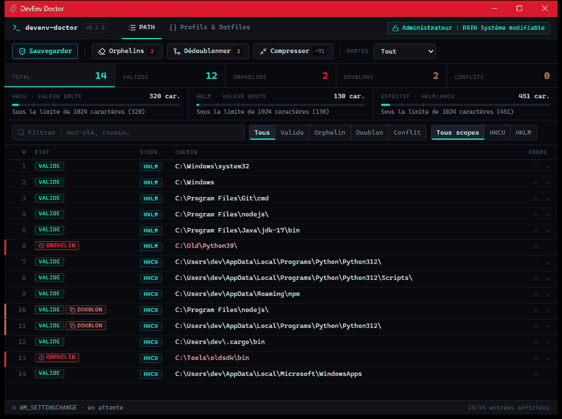
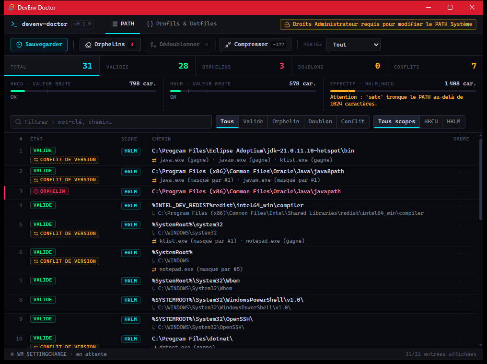
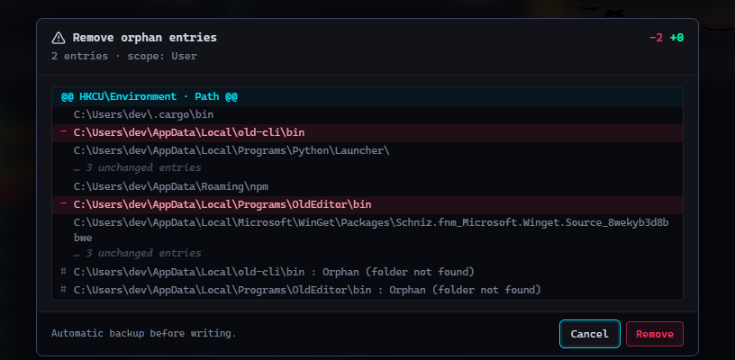

# DevEnv Doctor (v0.2.0)

🇬🇧 [English version](README.en.md)

[](https://github.com/TxF-AI/devenv-doctor/releases/latest)


[](LICENSE)

**Gestionnaire et nettoyeur intelligent du `PATH` Windows et des variables d'environnement.**

Au fil des installations (Python, Node, Java, Git, SDK…), le `PATH` se remplit de dossiers disparus, d'entrées en double et de binaires qui se masquent entre eux. DevEnv Doctor lit le Registre, te montre exactement ce qui ne va pas, puis le corrige avec un aperçu, une sauvegarde automatique et une restauration en un clic.

Application de bureau native (Rust + Tauri v2), un seul exécutable de moins de 5 Mo. Rien n'est envoyé sur Internet.

## 🎨 Aperçu de l'Interface



*Démo animée (données fictives) : suppression des doublons avec aperçu « diff », puis compression du PATH (−59 caractères).*

<details>
<summary>Captures statiques</summary>

<p align="center">
  
</p>

Interface **HUD cyberpunk compacte**, pensée comme un outil de développeur : fond obsidienne, accents réservés aux statuts, police monospace. Le tableau dense liste le PATH dans l'ordre de résolution de Windows, avec des **filtres dynamiques** (mot-clé, état, scope), des badges **Valide / Orphelin / Doublon / Conflit de version** (une barre rouge ou ambre sur le côté repère les lignes à traiter), les jauges de longueur du PATH et les boutons ⬆ / ⬇ de priorité.

L’interface est disponible en **français et en anglais** : sélecteur FR/EN dans la barre du haut (langue du système par défaut, choix mémorisé ; messages d’erreur et script PowerShell exporté suivent la langue choisie).

<p align="center">
  
</p>

Avant toute écriture, une **modale de confirmation en mode « diff Git »** montre exactement ce qui sera retiré (lignes `−` en rouge, entrées inchangées repliées). Dans ces captures, le nom d'utilisateur Windows est masqué (`dev`).

</details>

## Fonctionnalités

- 🧹 **Nettoyage intelligent** : détection des **orphelins** (dossiers qui n'existent plus) et des **doublons**, dans le PATH Utilisateur (HKCU) et Système (HKLM). Les entrées dont l'absence n'est pas certaine (variable non résolue, chemin réseau) sont épargnées.
- ⚡ **Live Broadcast** : après chaque modification, DevEnv Doctor diffuse `WM_SETTINGCHANGE` à Windows. Les **nouveaux** terminaux et programmes voient le changement sans redémarrer la session (les programmes déjà ouverts gardent leur ancien environnement).
- 📏 **PATH Compressor & Diagnostic** : longueur de HKCU, de HKLM et du PATH effectif, avec une alerte avant les limites de **1024** (`setx`), **2048** et **8192** caractères. La compression remplace `C:\Users\<nom>`, `AppData` et le dossier Windows par des variables (`%USERPROFILE%`, `%LOCALAPPDATA%`, `%APPDATA%`, `%windir%`), seulement quand l'entrée devient plus courte.
- ⚠️ **Détection des conflits** : repère les binaires de même nom présents dans plusieurs dossiers du PATH (`python.exe`, `node.exe`, `git.exe`…), indique lequel Windows lance et lesquels sont masqués. Les ⬆ / ⬇ de chaque ligne règlent la priorité.
- 🛡️ **Sécurité & Backups** : aucune écriture sans aperçu en « diff » et confirmation. Une sauvegarde JSON est créée automatiquement dans `%APPDATA%\com.txfai.devenvdoctor\backups\`, avec **restauration en un clic**. Modifier le PATH Système demande de lancer l'application en administrateur.
- 📜 **Export Dotfiles & PowerShell** : export du PATH et des variables utilisateur en JSON (profils et presets `Minimal Clean`, `WebDev`, `GameDev`) ou en script `setup-env.ps1` autonome pour reconfigurer un PC vierge. Les exports ne contiennent **ni secrets** (variables dont le nom évoque un token, une clé ou un mot de passe) **ni nom d'utilisateur**.

## Installation

1. Télécharge l'exécutable : **[devenv-doctor.exe (v0.2.0)](https://github.com/TxF-AI/devenv-doctor/releases/download/v0.2.0/devenv-doctor.exe)** (4,5 Mo), ou consulte la page de la [Release v0.2.0](https://github.com/TxF-AI/devenv-doctor/releases/tag/v0.2.0).
2. Vérifie son empreinte :

   ```powershell
   Get-FileHash -Algorithm SHA256 .\devenv-doctor.exe
   ```

   Le résultat doit être :

   ```
   68E2E215D1A2B2621E404A4F0B3AF56F67F0DD4A86AB485D8070F1CD0086F986
   ```

3. Double-clique sur `devenv-doctor.exe`. Aucune installation : le fichier est portable.

**Prérequis :** Windows 10 ou 11 (64 bits) avec Microsoft Edge WebView2, déjà présent sur Windows 11 et sur les Windows 10 à jour.

> ### ⚠️ Windows SmartScreen
> L'exécutable **n'est pas signé numériquement** (pas de certificat de signature de code). Au premier lancement, Windows peut afficher « Windows a protégé votre ordinateur » : clique sur **Informations complémentaires**, puis **Exécuter quand même**. Compare toujours l'empreinte SHA-256 ci-dessus avant de le lancer. Tu peux aussi lever le blocage avec `Unblock-File .\devenv-doctor.exe`.

## Utilisation

- **Onglet PATH** : un tableau unique (Système puis Utilisateur, dans l'ordre de résolution de Windows) avec l'état de chaque entrée : Valide, Orphelin, Doublon, Conflit de version. Filtre par mot-clé (`Ctrl+F`), par état ou par scope ; les compteurs du haut sont cliquables.
- **Barre d'actions** : *Sauvegarder*, *Orphelins*, *Dédoublonner*, *Compresser*. Le sélecteur **Portée** limite l'action à l'Utilisateur, au Système ou aux deux. Chaque action ouvre un aperçu en diff avant d'écrire.
- **Onglet Profils & Dotfiles** : export JSON, import d'un profil, export du script PowerShell, presets et liste des sauvegardes à restaurer.
- **Script généré** : pour le tester sans rien modifier, lance
  `powershell -NoProfile -ExecutionPolicy Bypass -File .\setup-env.ps1 -WhatIf`
  (`-OnlyExisting` n'ajoute que les dossiers déjà présents sur le PC).

## Compiler depuis les sources

Prérequis : Rust (stable, MSVC), Node.js et les Build Tools C++ de Visual Studio.

```powershell
npm install
npm run tauri dev                          # développement
cd src-tauri; cargo test                   # tests unitaires
cd src-tauri; cargo clippy --all-targets   # lint
npm run tauri build -- --no-bundle         # exécutable : src-tauri\target\release\devenv-doctor.exe
```

Sans `--no-bundle`, Tauri télécharge WiX et NSIS pour produire des installateurs MSI et setup.

## Structure

| Chemin | Rôle |
|---|---|
| `src-tauri/src/lib.rs` | lecture du Registre (PATH Utilisateur et Système), commandes Tauri |
| `src-tauri/src/actions.rs` | sauvegardes, restauration, nettoyage, diffusion `WM_SETTINGCHANGE` |
| `src-tauri/src/optimize.rs` | longueur du PATH, compression, réordonnancement, conflits |
| `src-tauri/src/profiles.rs` | profils, presets, export JSON et script PowerShell |
| `src/`, `index.html` | interface (JavaScript, Vite, Tailwind) |
| `CLAUDE.md` | mémoire du projet : commandes, conventions et leçons apprises |

## 📜 Licence

Ce projet est distribué sous licence **MIT** : tu peux l'utiliser, le copier, le modifier et le redistribuer librement, à condition de conserver la mention de copyright. Le texte complet est dans le fichier [LICENSE](LICENSE). Copyright (c) 2026 TxF-AI.
